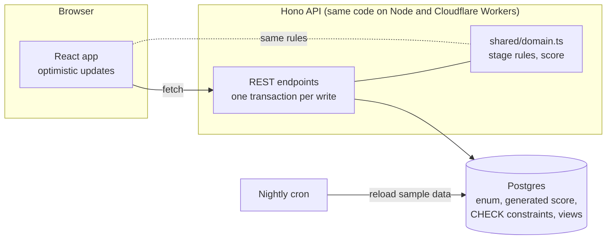

# gtm-backlog

[](https://github.com/bryanacevedo/gtm-backlog/actions/workflows/ci.yml)

**The backlog for a GTM engineering team.** Requests land in one inbox, get ranked by what they're worth to revenue, move from idea to live, and keep reporting what they did after they ship.

**Live demo:** https://gtm-backlog.onrender.com (sample data, editable, resets nightly; the free plan sleeps when idle, so the first visit can take a minute)

[](https://gtm-backlog.onrender.com/video/gtm-backlog.mp4)


## The problem

Sales, marketing, partnerships and RevOps all ask GTM engineering for "a quick automation". The requests arrive in DMs, threads and meetings. Nobody can see what's queued, why one thing was built before another, or what the shipped work did. When leadership asks what GTM engineering delivered this month, someone rebuilds the answer from memory.

## What it does

- **Triage is an inbox.** Each request arrives with who asked and why. You set four inputs and watch where it would land in the queue before you accept, merge or decline it. Declines need a reason the requester can read.
- **The Queue ranks by value per day of work:** impact × reach × (confidence ÷ 100) ÷ effort. Every input has its own column, and a score nobody has confirmed in 60 days fades and says so.
- **The Board moves work from idea to building to live.** Nothing goes live without a link to the running system.
- **Shipped is the leadership changelog.** It groups work by month and shows each system's latest measured result. A live system with no result for 30 days is flagged as silent.

| | |
|---|---|
|  |  |
|  |  |

## Run it

Needs Node 22.18 or newer (it runs TypeScript directly). Nothing else: no accounts, no keys, no Docker.

```bash
git clone https://github.com/bryanacevedo/gtm-backlog && cd gtm-backlog
npm install
make demo        # builds, loads the sample backlog, serves http://localhost:8787
```

The demo runs real Postgres inside the process ([PGlite](https://pglite.dev)), stored in `.data/`. It always uses that built-in database, even if your shell has `DATABASE_URL` set, so it can never reset a real one.

**Your own Postgres** (Supabase, Neon, RDS, local):

```bash
npm run build
DATABASE_URL=postgresql://… WRITE_KEY=choose-a-secret npm start
```

Migrations apply on start. Your database starts empty; add `SEED_SAMPLE=1` only if you want the sample backlog in it. With `WRITE_KEY` set, changes need that key, so leave it unset only on a private network.

**Deploy to Render, one link with two spaces:** `render.yaml` runs `node src/server/node.ts --hosted` (health check `/api/health`). Everyone who is not signed in sees a page with two buttons:

- **Try the demo** opens the sample backlog (PGlite, inside the instance). Anyone can use it, edits stay in it, and it reloads every night at 06:00 UTC and on every start, so a sleeping free service wakes up fresh.
- **Sign in with Google** opens the real backlog (Postgres at `DATABASE_URL`) for allowlisted accounts. No sample is ever loaded into it. A signed-in user can switch to the demo and back from the left rail.

The two spaces share nothing. The space is chosen from the caller's credentials, never from anything the request names, so a demo visitor, or a request with a forged or expired cookie, cannot read or write the real space; tests cover this at the API.

With `DATABASE_URL` or the Google settings missing, the app runs demo-only and opens straight on the demo, as before. Migrations for the real space run on start, under a database lock so two servers starting together cannot both migrate. If the real database is down, the demo keeps working and the real space answers "not reachable" until it is back (it retries after 15 seconds). `npm run migrate` still applies them by hand.

### Settings (environment only)

| Variable | Needed for | What it is |
|---|---|---|
| `DATABASE_URL` | the real space | Postgres connection string. The real space exists only when this is set. Hosted mode never loads the sample into it, and `SEED_SAMPLE` is ignored. |
| `GOOGLE_CLIENT_ID` | sign-in | OAuth client ID of a Google Cloud "Web application" client. |
| `GOOGLE_CLIENT_SECRET` | sign-in | That client's secret. |
| `SESSION_SECRET` | sign-in | At least 32 random characters (`openssl rand -base64 48`). Signs the session cookie. Changing it signs everyone out. |
| `PUBLIC_URL` | sign-in | The site's address with no path, for example `https://gtm-backlog.onrender.com`. The redirect URI is `${PUBLIC_URL}/auth/google/callback`. It must be `https`, except for localhost. |
| `ALLOWED_EMAILS` | sign-in | Comma list of Google addresses that may enter, for example `me@example.com,ana@example.com`. Case-insensitive. |
| `ALLOWED_DOMAIN` | sign-in | A domain whose every address may enter, for example `example.com` (exact match: subdomains and look-alikes do not count). The account must also be a Google Workspace account of that domain (Google's `hd` claim), so a personal Google account that once used a work address does not count. Use it alone or together with `ALLOWED_EMAILS` (the way in for addresses outside Workspace); at least one of the two is required. |
| `WRITE_KEY` | scripts | Optional. A request with the header `x-write-key: <key>` and an `x-actor` name reaches the real space without a browser session. A wrong key is refused, never sent to the demo. |
| `PUBLIC_DEMO` | free host | Set to `1` on a small host so the demo opens from `samples/demo-snapshot.tgz` (see PROJECT-STATUS). |

Sign-in turns on only when `DATABASE_URL`, `GOOGLE_CLIENT_ID`, `GOOGLE_CLIENT_SECRET`, `SESSION_SECRET`, `PUBLIC_URL` and one of the two allowlist settings are all present and valid; the server log says what is missing.

**Set up Google sign-in.** In Google Cloud Console, create an OAuth client of type "Web application" (APIs and Services, Credentials) and add this under Authorized redirect URIs. For the live site that is exactly:

```
https://gtm-backlog.onrender.com/auth/google/callback
```

Add `http://localhost:8921/auth/google/callback` as well to try it locally with `PUBLIC_URL=http://localhost:8921`. The scopes are `openid email profile`. The server uses the authorization code flow with PKCE (S256), `state` and `nonce`, and accepts an ID token only if its RS256 signature matches Google's published keys and its issuer, audience, expiry and nonce check out and the email is verified. Then the address must be on the allowlist, and is checked again on every request, so removing one from `ALLOWED_EMAILS` locks that person out at once.

The session is a signed cookie (`__Host-bl_session`; `bl_session` on plain-http localhost): httpOnly, `Secure`, `SameSite=Lax`, valid for 7 days, ended by Sign out in that browser. It is stateless: a copied cookie stays valid until it expires, so to end every session at once, change `SESSION_SECRET`, and to lock out one person, remove them from the allowlist. Changes made from a browser in the real space are logged under the Google name, not under whatever the browser sends. Script changes made with `WRITE_KEY` are logged as `script: <x-actor>`.

**Deploy to Cloudflare Workers:** run `DATABASE_URL=… npm run migrate` once, then `npx wrangler secret put DATABASE_URL` and `npm run deploy`. The Worker does not run migrations itself.

**Checks:** `make test` runs the unit tests, the database tests (real Postgres via PGlite) and the typecheck. `node scripts/audit-layout.mjs` checks alignment in a real browser against the running demo (`make demo` first; set `CHROME` to your Chrome binary outside macOS).

## Architecture



| Layer | Choice | Why |
|---|---|---|
| Rules | `src/shared/domain.ts`, pure functions | The API enforces them, and the app uses the same code to apply moves before the server answers, so the two can't disagree. |
| API | Hono, one transaction per write, every write logged as an event | The activity feed doubles as the audit trail. Moves lock the row, so two people can't both win a race. |
| Database | Postgres 15+ | Stage enum; `CHECK` constraints for "live needs a system link", "declined or retired needs a reason", no self-merge and every input range. The rules hold even if someone skips the API. A generated `score` column and a ranked `queue` view mirror the app's math for reporting, and a test proves they match. |
| Local | PGlite (Postgres compiled to WebAssembly) | `make demo` works on any machine with Node and nothing else. |
| Hosted | Render (Node: PGlite for the demo, Postgres for the real space) or Cloudflare Workers + Supabase Postgres | The same Hono app as local. Render serves both spaces behind Google sign-in; a nightly timer (a cron on Workers) reloads the demo. |
| UI | React + Vite, no component library | Small, fast, and every component built for this product. |

More detail: [docs/SPEC.md](docs/SPEC.md) for the product, and [docs/DECISIONS.md](docs/DECISIONS.md) for the trade-offs.

## What's real and what's sample

- **Real:** the rules, the API, the database schema, the scoring, every view, keyboard control, optimistic moves with rollback, the activity log, and the nightly reset. The hosted demo needs no key, so visitors can try everything; it resets every night.
- **Sample:** the 24 requests and the people. The team and their names are fictional. Avatar photos are from Unsplash (see [CREDITS.md](CREDITS.md)).
- **Not built yet:** Slack intake (`/request`) and roles. Sign-in is all-or-nothing: everyone on the allowlist can change everything.

## Keyboard

`1` to `4` switch views, `j` and `k` move through rows (Triage, Queue, Board), `↵` opens, `←` and `→` move a card between stages, `a`, `m` and `d` decide in Triage, `c` opens a new request, `Esc` closes or goes back, `?` lists every key.

## License

[PolyForm Noncommercial 1.0.0](LICENSE.md). Read it, run it, learn from it. Using it inside a business needs a commercial license: bryan@leandrive.io.

Built by [Bryan Acevedo](https://github.com/bryanacevedo).
