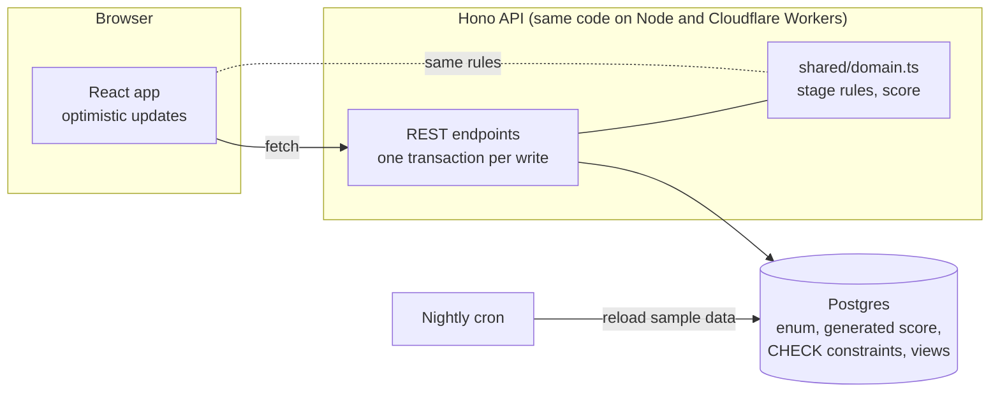

# gtm-backlog

**The backlog for a GTM engineering team.** Requests land in one inbox, get ranked by what they're worth to revenue, move from idea to live, and keep reporting what they did after they ship.

**Live demo:** https://gtm-backlog.leandrive.workers.dev (sample data, editable, resets nightly)


## The problem

Sales, marketing, partnerships and RevOps all ask GTM engineering for "a quick automation". The requests arrive in DMs, threads and meetings. Nobody can see what's queued, why one thing was built before another, or what the shipped work did. When leadership asks what GTM engineering delivered this month, someone rebuilds the answer from memory.

## What it does

- **Triage is an inbox.** Each request arrives with who asked and why. You set four inputs and watch where it would land in the queue before you accept, merge or decline it. Declines need a reason the requester can read.
- **The Queue ranks by value per day of work:** impact × reach × confidence ÷ effort. Every input has its own column, and a score nobody has checked in 60 days fades and says so.
- **The Board moves work from idea to building to live.** Nothing goes live without a link to the running system.
- **Shipped is the leadership changelog.** It groups work by month and shows each system's latest measured result. A live system with no result for 30 days is flagged as silent.

| | |
|---|---|
|  |  |
|  |  |

## Run it

```bash
git clone https://github.com/bryanacevedo/gtm-backlog && cd gtm-backlog
npm install
make demo        # builds, loads the sample backlog, serves http://localhost:8787
```

No accounts, no keys, no Docker. The demo runs real Postgres inside the process ([PGlite](https://pglite.dev)), with the data stored in `.data/`.

To use your own Postgres (Supabase, Neon, RDS, local), set `DATABASE_URL`. Migrations apply on start.

```bash
DATABASE_URL=postgresql://… npm start
```

`make test` runs the unit tests and the typecheck. `node scripts/audit-layout.mjs` checks alignment in a real browser (needs Chrome).

## Architecture



| Layer | Choice | Why |
|---|---|---|
| Rules | `src/shared/domain.ts`, pure functions | The API enforces them, and the app uses the same code to apply moves before the server answers, so the two can't disagree. |
| API | Hono, one transaction per write, every write logged as an event | The activity feed doubles as the audit trail. Moves lock the row, so two people can't both win a race. |
| Database | Postgres 15+ | Stage enum; score as a generated column; `CHECK` constraints for "live needs a system link" and "declined needs a reason"; a ranked `queue` view. The rules hold even if someone skips the API. |
| Local | PGlite (Postgres compiled to WebAssembly) | `make demo` works on any machine with Node and nothing else. |
| Hosted | Cloudflare Workers + Supabase Postgres | The same Hono app as local. A nightly cron reloads the demo. |
| UI | React + Vite, no component library | Small, fast, and every component built for this product. |

More detail: [docs/SPEC.md](docs/SPEC.md) for the product, and [docs/DECISIONS.md](docs/DECISIONS.md) for the trade-offs.

## What's real and what's sample

- **Real:** the rules, the API, the database schema, the scoring, every view, keyboard control, optimistic moves with rollback, the activity log, and the nightly reset.
- **Sample:** the 24 requests and the people. The team and their names are fictional. Avatar photos are from Unsplash (see [CREDITS.md](CREDITS.md)).
- **Not built yet:** Slack intake (`/request`), roles and per-person accounts.

## Keyboard

`1` to `4` switch views, `j` and `k` move through rows, `↵` opens, `←` and `→` move a card between stages, `a`, `m` and `d` decide in Triage, `c` opens a new request, `?` lists every key.

## License

[PolyForm Noncommercial 1.0.0](LICENSE.md). Read it, run it, learn from it. Using it inside a business needs a commercial license: bryan@leandrive.io.

Built by [Bryan Acevedo](https://github.com/bryanacevedo).
